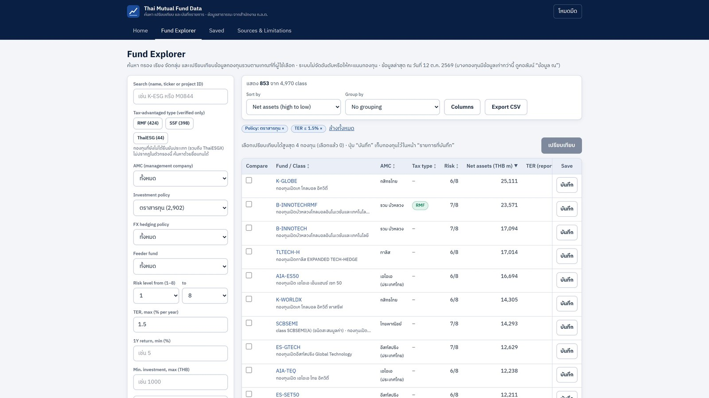
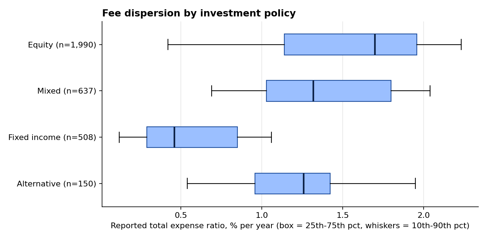
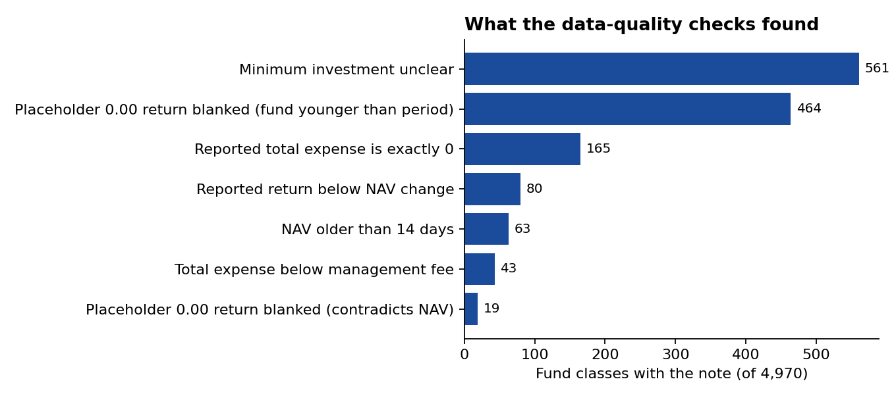
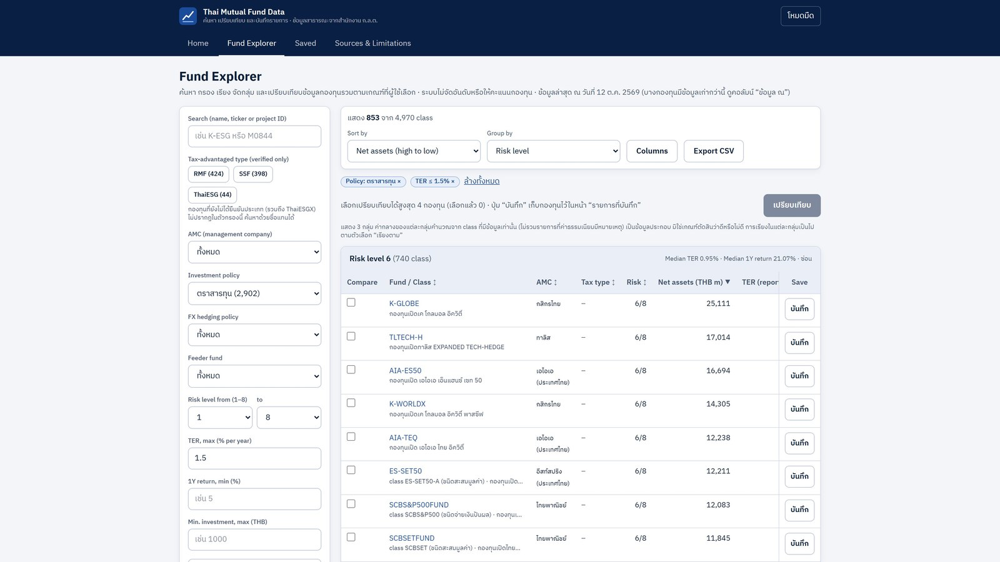
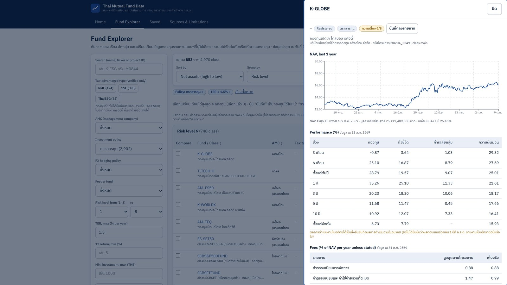
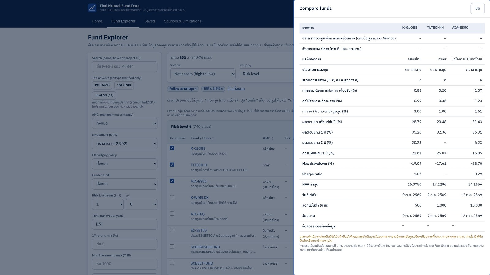
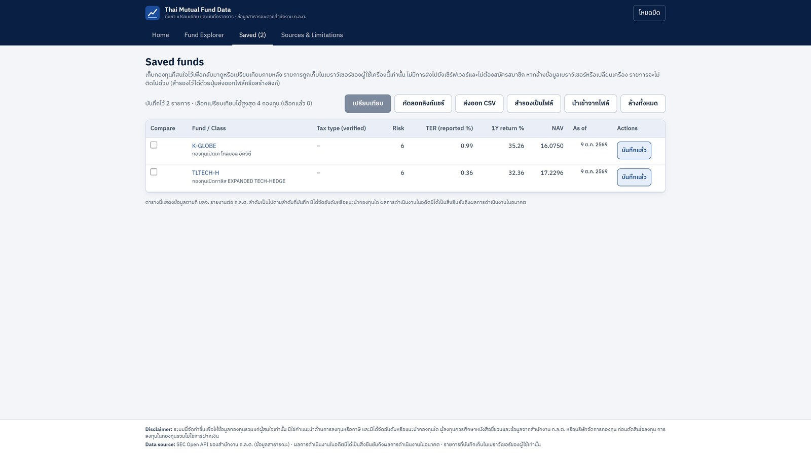

# Thai Mutual Fund Data: Comparing 4,970 Fund Classes, and Knowing Which Numbers to Trust

A fund-screening website built on the Thai SEC's public Open API: how I collected the data, checked it, and what it shows about fees, risk and data quality across the Thai mutual fund market.

**Tools:** Python (pandas, FastAPI) · React + TypeScript (Vite, Tailwind, TanStack Table, Recharts) · SEC Open API V2
**Data:** [SEC Thailand Open API](https://secopendata.sec.or.th) fund endpoints, snapshot of 12 October 2026 (data files are not included in this repository, see [Assumptions and Caveats](#assumptions-and-caveats))

## Table of Contents

- [Project Background](#project-background)
- [Executive Summary](#executive-summary)
- [How the Data Was Built](#how-the-data-was-built)
  * [1. Exploring the API](#1-exploring-the-api)
  * [2. Classifying tax-advantaged funds](#2-classifying-tax-advantaged-funds)
  * [3. Collecting every fund](#3-collecting-every-fund)
  * [4. Building one table and auditing it](#4-building-one-table-and-auditing-it)
- [Insights Deep-Dive](#insights-deep-dive)
  * [Fee Dispersion](#fee-dispersion)
  * [Fees and Risk Level](#fees-and-risk-level)
  * [What the Data-Quality Checks Found](#what-the-data-quality-checks-found)
  * [Tax-Fund Labels](#tax-fund-labels)
- [The Website](#the-website)
- [Recommendations](#recommendations)
- [How I Worked with AI Tools](#how-i-worked-with-ai-tools)
- [Assumptions and Caveats](#assumptions-and-caveats)
- [Repository Structure](#repository-structure)

---

## Project Background

Thai investors choose from thousands of mutual funds, and the same fund is often sold in several unit classes with different fees. The SEC publishes the underlying numbers (fees, returns, NAV, risk level, asset allocation), but only through an API with one endpoint per topic, so comparing funds fairly means joining about a dozen sources and deciding what to do with the gaps and oddities.

I took the role of an analyst who needs to **screen funds on criteria they choose, compare a few side by side, and know which figures are safe to rely on**. The product is a read-only website; the more interesting work is the data underneath it.

The final table covers **4,970 live fund classes in 2,398 projects from 22 asset managers** (the registry lists 11,670 class profiles in total, including funds no longer open). Figures are as reported by the asset managers; the latest NAV date in the snapshot is 12 October 2026.

An early version also calculated tax savings from RMF/ThaiESG purchases. I removed it, and its code, because I could not verify the calculation against the Revenue Department's own system, and a tool that quotes tax figures should not ship unverified. The project is now fund data only.

## Executive Summary

Four findings from the data:

1. **Fees vary widely inside the same fund type.** For equity funds the reported total expense ratio (TER) runs from **0.42% to 2.23%** (10th to 90th percentile, median 1.70%). For fixed-income funds it is **0.12% to 1.06%** (median 0.46%). Across the market, **14.6%** of classes report a TER above 2% a year.
2. **Fees rise with risk, then flatten.** The median TER climbs from 0.25% at risk level 1 to 1.70% at level 6, then eases to 1.54% and 1.26% at levels 7 and 8.
3. **A fee gap compounds.** As an illustration, not a finding: on THB 1m growing 6% a year before fees for 10 years, a 1.2-point TER gap leaves about THB 190k less at the end (THB 1.60m vs 1.79m).
4. **About one class in five needs a caution.** **1,132 of 4,970 classes (22.8%)** carry at least one data note, such as a "0.00" return that really means "fund too young", or a minimum investment that is not a clear baht amount. A fee sort that ignored this would put funds reporting a total expense of exactly 0 first.

The site therefore shows blanks instead of fake zeros, pushes unreliable fees to the end of fee sorts, and never ranks or recommends a fund.



## How the Data Was Built

### 1. Exploring the API

The API has no single "fund" table. I started from the management-company list, then the fund profiles, then one endpoint per topic (fees, performance, statistics, risk spectrum, asset allocation, top-5 holdings, benchmarks, minimum subscription, documents, daily NAV). Probing with a few sample funds settled the details the documentation leaves open:

- results page with a cursor (`next_cursor`), 100 rows per page;
- filtering profiles by company works with `company_info` (an `amc_id` parameter is rejected);
- `latest=true` returns only the newest record on most endpoints, which cuts the number of calls per fund from about 47 to about 13 when combined with a one-year NAV window;
- data arrives as a full history in no particular order, and missing values come as the text `"None"`, so the latest record must be chosen by date.

### 2. Classifying tax-advantaged funds

The API tags only SSF and ThaiESG funds, and never RMF, so RMF and ThaiESGX had to be inferred from fund names by rules ([`scripts/fund_type_rules.py`](scripts/fund_type_rules.py)). Descriptions and policy text were deliberately **not** used, because they mention other tax products (an SSF description talks about RMF; an old LTF fund says it cannot be deducted).

I then checked RMF against the SEC's own per-fund report (as of 31 July 2026): **423 of my 437 RMF classes matched the report's RMF table**, and none appeared in the SSF table. The remaining 14 are 13 projects registered (or still in their offering period) after the report date, and one old fund that is missing from the report but confirmed on the SEC's own fund page. ThaiESG/ThaiESGX could not be checked against any official list, so they carry no label on the site. Details in [`docs/sec_report_comparison.md`](docs/sec_report_comparison.md).

### 3. Collecting every fund

A 35-project pilot (1,664 requests, no rate-limit errors) fixed the request plan. The full run covers every live project, about **27,000 requests** at 1 to 2 per second, with a checkpoint per project so it can resume after an interruption and stops at once on repeated HTTP 429 ([`scripts/12_fetch_all_funds.py`](scripts/12_fetch_all_funds.py)). The API key is read only from a local `.env` file and is never printed, logged or sent to the browser.

### 4. Building one table and auditing it

[`scripts/08_build_funds_table.py`](scripts/08_build_funds_table.py) joins everything at the class level (key = project ID + class name). About 5% of classes are named differently in the profile and in the other endpoints (a single-class fund called `main` in one and by its real name in the other), so the join falls back to the project ID when a project has one class, and leaves class-level fields blank rather than borrow another class's numbers when it cannot match (22 classes).

Then a second, independent script ([`scripts/14_audit_all_funds.py`](scripts/14_audit_all_funds.py)) recomputed every field from the raw files and compared it with the table: **0 mismatches** across all checked fields. It also applies plausibility checks (fee ranges, NAV against reported returns, stale NAV) and writes the notes described below. A separate test enforces that the note texts shown in the website match those in the Python layer.

## Insights Deep-Dive

### Fee Dispersion

- Base: 3,285 classes that report a TER above 0 and carry no fee note, with a known investment policy.
- Equity median 1.70% (n=1,990), mixed 1.32% (n=637), alternative 1.26% (n=150), fixed income 0.46% (n=508).
- The spread within a type is as large as the gap between types: the cheapest tenth of equity classes charge 0.42%, the dearest tenth 2.23% or more.
- TER is a backward-looking, reported figure. Some funds include VAT and some do not (not confirmed per fund), so small differences should not be over-read.



### Fees and Risk Level

| Risk level | 1 | 2 | 3 | 4 | 5 | 6 | 7 | 8 |
|---|---|---|---|---|---|---|---|---|
| Median TER, % | 0.25 | 0.29 | 0.30 | 0.47 | 1.24 | 1.70 | 1.54 | 1.26 |
| Classes | 58 | 19 | 74 | 249 | 553 | 1,869 | 253 | 196 |

Risk is the SEC's 1-to-8 spectrum (a handful of classes are rated "8+", shown as such). Level 6 holds the most classes (1,869). I did not investigate why the median eases at levels 7 and 8.

### What the Data-Quality Checks Found

1,132 of 4,970 classes (22.8%) carry at least one note. The largest groups:

- **Minimum investment unclear (561):** reported in another currency, with another unit, or as 0 without saying "no minimum". Shown blank with a note, except when the source clearly says "no minimum".
- **Placeholder zero returns (464 + 19):** a fund younger than a period reports 0.00 for it, and in 19 cases the NAV moved a lot while the return was 0.00. These are shown as blank, not as a 0% return.
- **Total expense exactly 0 (165):** could mean "not reported" or a fee waiver. These are never treated as the cheapest fund and sort last on fees.
- **Reported return below the NAV change (80):** a dividend cannot explain a lower return, so these are flagged for checking against the fact sheet, not changed.

The notes say "check the source document", not "wrong": for example a total expense below the management fee (43) can simply mean the two figures cover different periods, as the ES-CHINAA-SSF fact sheet shows (annual-report period against current fee).



### Tax-Fund Labels

The website labels RMF, SSF and ThaiESG only where the label is verified: the SEC states it in its own data (SSF, ThaiESG), or the fund matches the SEC's RMF report. Everything else, including all ThaiESGX funds, has no label and does not appear in the tax-type filter, rather than showing a guess. The tax exemption for SSF purchases ended with income year 2024 under Ministerial Regulation No. 357 (2020) and I found no extension, so SSF funds remain listed as ordinary funds.

## The Website

Everything runs on pre-built files: no API key, no external call and no user account in the browser. Saved funds live in the browser's own storage; they can be exported to a file or shared as a link.

| Group funds, with medians per group | Fund detail |
|---|---|
|  |  |

| Compare up to four funds | Saved list |
|---|---|
|  |  |

- **Search and filter** by name or ID, management company, investment policy, FX hedging policy, feeder fund, risk level, fees, returns, minimum investment and verified tax type, with live counts.
- **Sort and group** by any column or preset, and group by risk, policy, company or FX policy with group medians.
- **Fund detail** with one-year NAV, performance against benchmark, fees (maximum against actually charged), risk statistics, asset allocation, top holdings and fact-sheet links.
- **Design rules:** no ranking, scoring or "best fund" wording; missing data is a dash, never zero; every figure shows its as-of date; a data note appears wherever a check fired.

## Recommendations

These are for someone screening funds with this data.

**Compare like with like**
- **Compare fees inside the same policy and risk level.** A 1.5% equity fund and a 1.5% bond fund are not in the same position (the bond median is 0.46%).
- **Look at the distribution, not only a favourite fund.** Use the group medians in the grouped view to see where a fund sits.

**Treat gaps with care**
- **Treat a total expense of exactly 0 as missing**, not as the cheapest fund.
- **Read a blank as "no data", never as zero.** Filters on fees or returns hide funds with no value; that is deliberate.
- **Check the as-of date** next to each figure; managers report on different cycles.

**For the data publisher (wish list, not a criticism)**
- A real inception date per class, an explicit null instead of `0.00`, a flag for dividend-adjusted returns, and a clear "no minimum" value would remove most of the notes above.

## How I Worked with AI Tools

I built this with AI coding assistants: Claude Code did most of the work, and an earlier Streamlit prototype came from Codex before I replaced it with the FastAPI + React version. I treated the assistant as a fast junior engineer whose claims need checking, not as a source of truth.

**What I decided and owned**
- The question and the scope: fund data for screening, no ranking, and cutting the tax calculator and every label I could not verify.
- The rules the assistant works under, written in a project instruction file it reads each session (kept local): the API key is read only from `.env` and never printed; each rule or number about law, tax or the API is marked verified or unverified with its source; no "recommend" or "top pick" wording.
- What counts as verified: RMF against the SEC's report, API behaviour against real calls, data against the raw files.
- The steps only the owner can do: reading the SEC's API terms and asking the SEC about republishing (still pending, which is why no data or hosted site is published).

**What the assistant did**
- Wrote and refactored the code (resumable fetcher, table builder, API, React interface, 25 tests, charts, this demo video's Remotion project), ran the audit scripts, and drafted the documentation.

**How I kept it honest**
- **An audit separate from the builder.** I asked for a second script that recomputes every field from the raw files and compares it with the table, rather than trusting the builder's own checks (0 mismatches).
- **Claims checked against data and sources.** Errors caught this way include the end year of the SSF tax benefit (first stated as 2023, corrected to 2024 after checking the regulation), the count of classes with a USD minimum (53, corrected to 52) and the number of year-to-date zero returns affected by a rule (47, corrected to 36).
- **Tests that guard consistency**, for example one that fails if the data-note texts in the Python layer and in the website drift apart.
- **Cutting rather than hedging.** When the assistant could not show a label or number was reliable, I had it removed from the interface instead of adding a disclaimer.

**What I took from it:** the assistant is quick at code and drafting but cannot tell by itself when a statement is verified, so the verification gates, the independent audit and the source-labelling rules are where my judgement went.

## Assumptions and Caveats

- **As reported.** Figures come from the SEC API as the asset managers reported them. The only changes: `0.00` returns that stand for "no data" shown blank; non-baht or unclear minimums shown blank with a note; the "8+" risk label kept as such.
- **Snapshot, not live.** The data is a point-in-time pull (latest record per fund plus one year of NAV); managers report on different dates, shown in the as-of column.
- **Associations, not advice.** Fee and risk patterns describe the market, not what any fund will deliver. Past performance does not guarantee future results; the site is not investment or tax advice.
- **Unverified labels are hidden.** ThaiESG/ThaiESGX and 14 RMF classes could not be verified against an official source, so they show no tax label.
- **Fee definitions.** Whether TER includes VAT varies by manager and was not confirmed per fund; "maximum" fees in the source are not always a ceiling on total costs.
- **Independent audit scope.** The audit confirms the table matches the raw files and flags implausible values; it cannot confirm that the raw reports themselves are right.
- **Data not redistributed.** The SEC data files are not committed. The terms for republishing SEC API data are being confirmed, so a public data snapshot and a public hosted site are not provided. To run the project, supply your own SEC API key (see below).
- **Interface language.** The website uses English headings with Thai content, because fund names and the SEC's descriptions are in Thai.

---

- See the data dictionary and every derived column in [`docs/data_dictionary.md`](docs/data_dictionary.md).
- See the full audit output in [`docs/data_audit_all_funds.md`](docs/data_audit_all_funds.md).
- See the RMF verification in [`docs/sec_report_comparison.md`](docs/sec_report_comparison.md).
- See the notes on API terms in [`docs/sec_api_terms_check.md`](docs/sec_api_terms_check.md).

To reproduce (Python 3.11+, Node.js 20+; put your own key in `.env` as `SEC_API_KEY`, see `.env.example`):

```bash
python -m pip install -r requirements.txt
python scripts/01_fetch_profiles.py          # all fund profiles
python scripts/03_classify_fund_types.py     # tax-type rules, class level
python scripts/12_fetch_all_funds.py         # all live funds, resumable (~27,000 requests)
python scripts/08_build_funds_table.py --all # one table, no network
python scripts/14_audit_all_funds.py         # independent audit and notes
python scripts/16_readme_charts.py           # charts and figures used above
python run.py                                # website at http://127.0.0.1:8000
python -m pytest -q                          # tests
```

For a static copy that needs no Python server: `python scripts/15_export_static.py`, then `cd web && npm run build:static`.

## Repository Structure

```
├── README.md
├── requirements.txt
├── run.py                       start the website (production or --dev)
├── api/                         FastAPI, read-only over data/ (meta, funds, fund detail, NAV)
├── web/                         React + TypeScript frontend
├── scripts/
│   ├── sec_client.py            API client (key from .env only, rate limit aware)
│   ├── 01_fetch_profiles.py     fund profiles
│   ├── 02_probe_params.py       which filter parameters the API accepts
│   ├── 03_classify_fund_types.py  tax-type classification report
│   ├── fund_type_rules.py       name-based classification rules
│   ├── 05_probe_endpoints.py    endpoint discovery on sample funds
│   ├── 06_fetch_pilot.py        35-project pilot
│   ├── 11_compare_sec_ssf_report.py  RMF check against the SEC report
│   ├── 12_fetch_all_funds.py    full resumable fetch
│   ├── 08_build_funds_table.py  join everything into one class-level table
│   ├── data_quality.py          plausibility checks and fix rules
│   ├── 14_audit_all_funds.py    independent recomputation and audit
│   ├── 15_export_static.py      JSON export for static hosting
│   └── 16_readme_charts.py      charts and figures for this README
├── tests/                       API, classification rules, data-quality notes, fetcher
├── docs/                        data dictionary, audit, verification notes, screenshots, charts
├── video/                       Remotion project for the demo video
└── planner/, archive/           earlier tax calculator (not used by the website)
```

*Reference: SEC Thailand, Open API V2 documentation and per-fund report on SSF/RMF/LTF funds (as of 31 July 2026).*
